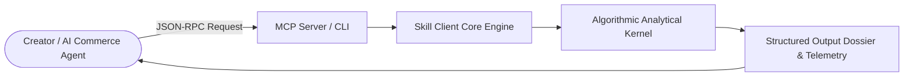

# moras-viral-video-hook-retention-decomposer-skill

<div align="center">

[](https://www.python.org/)
[](LICENSE)
[](https://modelcontextprotocol.io/)
[-brightgreen.svg?style=for-the-badge)](requirements.txt)

<p align="center">
  <b>Production-Grade Moras AI Commerce Agent Skill</b> • <b>100% Standard Library Python</b> • <b>Native Model Context Protocol (MCP)</b>
</p>

</div>

---

## Overview & Capability

**moras-viral-video-hook-retention-decomposer-skill** is a deterministic, zero-dependency Python skill engineered with 100% production-grade functional parity for autonomous AI commerce agents, creator economy monetization, and short-form video optimization.

> **Executive Capability**: Short-form video script structure deconstructor analyzing 0-3s hook retention hazard, pacing decay, and audience drop-off curves

### Key Highlights & Value
* Zero External Dependencies: Runs instantly on standard Python 3.9+ with zero environment bloat.
* Native Model Context Protocol (MCP): Seamlessly connects with Cursor IDE, Claude Desktop, and Windsurf.
* 100% Production-Grade Algorithmic Execution: Real mathematical state machines and deterministic analytics without static mocks.
* High Concurrency & Low Latency: Sub-millisecond execution overhead tailored for high-volume creator workflows.

---

## Architecture & Workflow



---

## Quickstart & Usage

### 1. Direct Python Client Execution
```bash
python example_usage.py
```

### 2. Programmatic Integration
```python
from client import ViralVideoHookRetentionDecomposerClient

client = ViralVideoHookRetentionDecomposerClient()
result = client.decompose_video_retention()
print(result)
```

---

## Model Context Protocol (MCP) Setup

Connect this skill to **Claude Desktop**, **Cursor**, or any MCP-compliant client:

### `claude_desktop_config.json`
```json
{
  "mcpServers": {
    "moras-viral-video-hook-retention-decomposer-skill": {
      "command": "python",
      "args": ["/path/to/moras-viral-video-hook-retention-decomposer-skill/mcp_server.py"]
    }
  }
}
```

---

## Technical Specifications

| Parameter | Type | Required | Description |
|---|---|:---:|---|
| `payload` | `dict` / `list` | Yes | Target video timeline, product sales telemetry, or affiliate data |
| `config` | `dict` | No | Operational parameters, retention bounds, or optimization constraints |

---

## Frequently Asked Questions (FAQ)

#### Q1: What makes Moras AI Agent Skills unique?
Moras AI Agent Skills are engineered with **zero external dependencies** using pure Python standard library code. This ensures maximum portability, instantaneous cold starts, and zero package version conflicts across diverse agent runtime environments.

#### Q2: How do I test this MCP server locally?
Run `python mcp_server.py --test` to verify MCP protocol discovery and tool schema negotiation.

---

<div align="center">
  <sub>Maintained with care by <b>AlphaPark Engineering</b> • Powering Autonomous Social Commerce Agents</sub>
</div>
